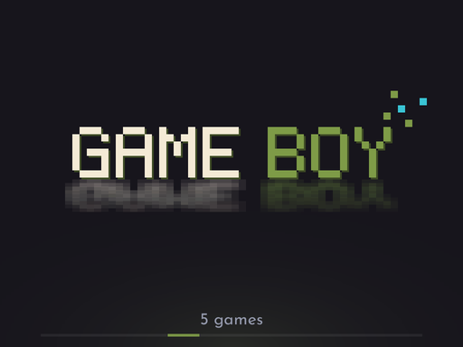
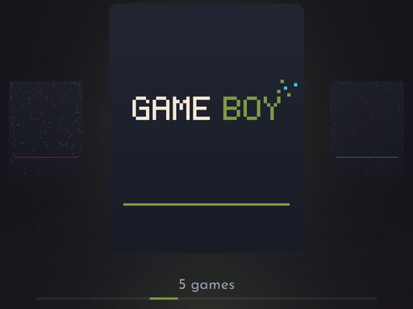
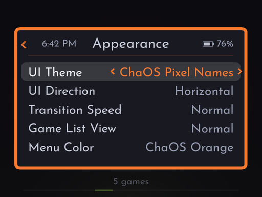

  

  <b>Custom firmware for the TrimUI Brick, with shaders made for each console built in.</b> 
  Eleven classic consoles and your music, a shader for every console, overlays for the handhelds, at whole-number, aspect or full-screen scale. 
  Built on <a href="https://github.com/ericreinsmidt/TortOS">TortOS</a> by Eric Reinsmidt.

  <a href="#install">Install</a> &nbsp;·&nbsp;
  <a href="#shaders">Shaders</a> &nbsp;·&nbsp;
  <a href="#overlays">Overlays</a> &nbsp;·&nbsp;
  <a href="#updates">Updates</a> &nbsp;·&nbsp;
  <a href="#supported-systems">Systems</a> &nbsp;·&nbsp;
  <a href="#controls">Controls</a> &nbsp;·&nbsp;
  <a href="#faq">FAQ</a> &nbsp;·&nbsp;
  <a href="#credits-and-license">Credits</a>

> [!WARNING]
> **ChaOS is still in testing and development.** Things may change from one release to the next, and some
> may not work as they should yet. Keep a copy of your saves, and please
> [report what you find](https://github.com/SkyWalker541/ChaOS/issues), with the logs if you can.

> [!IMPORTANT]
> **ChaOS is for the TrimUI Brick (and Brick Hammer) only at this time.**

<table>
  <tr>
    <td align="center"> ChaOS Pixel Names: each console in the logo's pixel letters</td>
    <td align="center"> ChaOS Pixel Cards</td>
  </tr>
  <tr>
    <td align="center"> Night Mode, and the clock and battery in every menu</td>
    <td align="center"> The look, on one page, in your color</td>
  </tr>
  <tr>
    <td align="center"> Each console's shader and its settings</td>
    <td align="center"> ChaOS Transfer and ChaOS Wire, from any browser</td>
  </tr>
</table>

## What's in it

**From ChaOS**

- **A shader for every console,** each one made for that console's screen, drawn by the Brick's CPU. PT SkyWalker541 for the Game Boys, a CRT for the TV consoles, an LCD for the other handhelds.
- **Overlays for Game Boy, Game Boy Color, Game Boy Advance, Game Gear and Neo Geo Pocket Color,** by SkyWalker541 and KrutzOtrem, and a folder on the card for every console where you can add your own.
- **See it before you choose it:** in the in-game menu, the paused game shows each shader setting and overlay as you scroll through them.
- **Display Mode** per console: **Integer** (whole-number scaling, so every pixel is the same size), **Aspect** (as large as the game's shape allows) or **Stretch** (the whole screen). Every shader works in all three.
- **Menu colors,** starting from ChaOS's orange.
- **Updates over Wi-Fi,** from the menu, when you choose, with what's new in each.
- **Button mapping,** per console or per game, with turbo, and **rewind**.
- **ChaOS Transfer,** the boot and power-off animations, and the ChaOS look throughout.
- **Two ChaOS UI Themes** (**MENU > Appearance > UI Theme**) where each console is its name in the logo's pixel letters, last word in the console's colour. **ChaOS Pixel Cards** puts the name on a card; **ChaOS Pixel Names** has no cards, just the name, large and the same size for every console, with a drop shadow and a soft reflection beneath it in the console's colour. As you scroll, the name you land on flies together pixel by pixel; with Pixel Cards the one you leave breaks apart too, and with Pixel Names it simply makes way for the next. The two themes leave out some directions: Pixel Cards has no Cubic, and Pixel Names runs horizontally only. **Transition Speed** (Slow, Normal, Fast or **Static**) sets how quickly, separately for each UI Direction; it's in the menu while either theme is on. Static turns the pixel movement off: each name or card appears in place at once, and a name over a game still shows for the same moment.
- **Screenshots** of any game with **MENU + X**, looked at again from the in-game menu.
- **Game List View** (**MENU > Appearance > Game List View**): **Normal** shows each system's games as the UI Theme draws them; **List** shows them as a scrolling list in the menus' style. Up and down move, left and right jump by letter, and L1 and R1 skip a screenful, as on the shelf. (Not in Cubic, which never opens a list.)
- **Night Mode** (**MENU > Night Mode**): eight extra volume steps below the quietest, for playing in bed. The volume buttons reach them while it's on.
- **The clock and battery in every menu,** in the menu's heading, on the main menu and in games. **MENU > Date & Time** sets 12- or 24-hour time, and whether the battery shows as an icon, a percentage or both.
- **Appearance** (**MENU > Appearance**): the UI Theme, UI Direction, Transition Speed, Game List View and Menu Color on one page, and switches for which shelves that aren't consoles show on the systems row: **Show Favorites**, **Show Recently Played** and **Show Muse** (SELECT opens Muse either way).
- **Every menu says what its rows do:** the row you're on is described in a line at the bottom of the menu, in-game menu included.
- **Recently Played,** a shelf at the front of the systems row with the last twelve games you played across every system. Turn it off under **MENU > Appearance > Show Recently Played**.
- **ChaOS Wire:** ChaOS Transfer over the USB cable, which can also update ChaOS from your computer.
- **Box art for homebrew,** from itch.io or one of your own screenshots, chosen from the game's **X** menu, or set from your phone in ChaOS Transfer: a photo, a picture's link, an itch.io page or a Google Images result.
- **Games come first:** nothing of ChaOS's own runs while you play. An update that was downloading pauses and picks up where it left off afterwards, with its progress shown on the shelf. Muse keeps playing.
- **Ports:** PC games rebuilt for handhelds, from [PortMaster](https://portmaster.games), on a **Ports** shelf of their own. See *Ports* below.
- **Letter scrubbing:** on any game shelf, in every theme, Game List View and Cubic, **L2** and **R2** jump to the first game of the previous or next letter with each press, and a square with the letter you're on fades in over the shelf. Hold the d-pad to scroll and after two seconds the same square shows the letter you're passing through. It fades out a moment after you stop.

**From TortOS**

- **Games start the moment you press A.** The emulator is already running, so nothing loads between you and the game.
- **Pick up where you left off.** Quit from the menu or press the power button: the game is saved on the way out and continues from that moment next time. Six save slots too.
- **Everything on the handheld:** Wi-Fi, box art, RetroAchievements, Bluetooth headphones and sending games over from your phone. You need a computer once, to set up the card.
- **Three ways to browse** (a row, a column or a cube) and two looks (Plain Jane or Fancy Pants), plus ChaOS Pixel Cards and ChaOS Pixel Names.
- **Muse,** a music and audiobook player, on SELECT from anywhere.
- **Turbo buttons, fast forward, mono audio, Play Time, favorites and sorting.** **Favorites** sits at the front of the systems row once a game is favorited: press **Y** on a game to add or remove it (the shelf says which, and a game's **X** menu reminds you).
- **The battery to the end:** a game is saved and the Brick turns off when the battery is truly empty, judged by its voltage, about half an hour later than its gauge's 2% allowed. The red dot blinks for the last stretch.
- **Your Brick stays yours.** ChaOS runs from the SD card and changes nothing on the Brick. Take the card out and it boots its own system again.

## Install

You need a TrimUI Brick or Brick Hammer, a microSD card and, just this once, a computer.

**The easy way:** [ChaOS Installer](https://github.com/SkyWalker541/ChaOS-Installer/releases/latest), for macOS, Windows and Linux. It downloads the latest ChaOS and puts it on the card, or updates a card that has ChaOS or TortOS on it already.

**By hand:**

1. Download `ChaOS-v<version>-brick.img.xz` from [Releases](https://github.com/SkyWalker541/ChaOS/releases/latest).
2. Write it to the card with a disk-image writer such as Raspberry Pi Imager or balenaEtcher. **This erases the card.**
3. Put the card in the Brick and turn it on. The first boot takes a little longer while it makes the rest of the card into space for games, music and saves.
4. Set your time zone under **MENU > Date & Time**.
5. Add games to the folders in `Roms/`: on a computer, where the card shows up as **ChaOS**, or over ChaOS Transfer.

### Updating

On the Brick: **MENU > Updates**, over Wi-Fi (see [Updates](#updates)). Over the USB cable: **MENU > ChaOS Wire**, then its page on your computer. Or put the card in the computer and choose **Update** in ChaOS Installer. Your games, music, saves and settings stay. A TortOS card becomes a ChaOS card the same way. Writing the image by hand erases the card, so use the installer to update.

> [!NOTE]
> **Coming from ChaOS 1.0.0 or earlier?** ChaOS 1.1.0 is built on TortOS 2.2.0, and an earlier Brick can't install it by itself: its Updates screen says **This one needs ChaOS Installer**. Update with [ChaOS Installer](https://github.com/SkyWalker541/ChaOS-Installer/releases/latest) once: put the card in the computer and choose **Update**. Your games, music, saves and settings stay. From 1.1.0 on, the Brick updates itself again, even when a release moves to a newer TortOS.

### Removing

Take the card out: the Brick boots its own system again. Everything ChaOS keeps is on the card, Wi-Fi passwords and Bluetooth pairings included, so reformat it before you give it away.

## Shaders

Each console's menu (MENU on its shelf) and the in-game menu have a **Shader** row. Each console offers only the shaders made for it:

| Consoles | Shader | By |
|---|---|---|
| Game Boy, Game Boy Color, Game Boy Advance | PT SkyWalker541, or lcd3x | SkyWalker541; Gigaherz |
| NES, SNES, Genesis, Master System, TurboGrafx-16 | crt-lottes-fast, or the lighter Scanlines | Timothy Lottes, adapted by hunterk; RiskyJumps |
| Game Gear, Neo Geo Pocket, Neo Geo Pocket Color | lcd3x | Gigaherz |

- **Left and right** turn it on and off. **A** opens its settings, showing only the ones that matter for what you've chosen.
- The CRT consoles have a **Style** row: **crt-lottes-fast** (scanlines, a phosphor mask and optional curvature) or **Scanlines**, plain scanlines that cost the CPU about a tenth as much. Use Scanlines if a game slows down with the CRT shader.
- The Game Boys have a **Style** row too: **PT SkyWalker541** or **lcd3x**, a simple LCD grid that looks the same at any size.
- PT's **Pixel Effect** (its Grid) follows the game's pixels, so it's drawn only when Display Mode is **Integer**, where every pixel is the same size; in Aspect and Stretch its rows are hidden and the grid is left off. For a grid in Aspect or Stretch, use the lcd3x Style. (PT's LCD Dot effect is gone: it was too slow on the Brick to keep games at full speed.)
- **Reset to Recommended** puts back the shader's own settings. For PT, that's its README's settings for that console. The CRT starts flat: curvature works, but costs the CPU about twice as much.
- **Speed**, in the in-game Shader menu, shows whether the game keeps full speed with the shader as set:
  - **Full Speed**: the frame has room to spare.
  - **Near the Limit**: it fits, just; a busy scene may slow down.
  - **Too Slow**: the game is slowing down. Try a lighter style or setting, or turn off curvature.

  **Shader Time** is the shader's share of each frame, and **Frame Time** the whole frame's work (the game, the shader and the screen) against the time a frame has at that console's rate, 16.6 ms on most. If Frame Time is high but Shader Time small, the console's emulator is the slow part, not the shader. The figures are measured while you play. Right after you change a setting, before the game has run with it, they're an estimate, marked **(est.)**; resume for a moment and pause again for the measured figures.
- Settings are saved per console.

## Button mapping and rewind

**Controls**, in each console's menu (MENU on its shelf) and in the in-game menu, shows that console's controls under its own name (**GB Controls**, **Genesis Controls**). It lists what each of the Brick's buttons does there now, then the shortcuts: MENU, fast forward, rewind if it's on, screenshot, and power. Left and right turn the pages.

**Button Mapping**, the first row of that screen, changes them. Each button can press:
- any of that console's buttons, by the console's own names (a Genesis has A, B, C, X, Y, Z and Mode);
- the same with **turbo**;
- or **None**.

Left and right change a button, and **Reset to Default** puts it back. The Game Boys, NES, Master System, Game Gear, TurboGrafx-16 and Neo Geo Pockets start with X and Y as turbo A and B, as before.

From a game, changes apply as you make them. The **For** row picks **This game**, a mapping for this game only, or **All its games**, the console's. The d-pad and MENU can't be remapped.

**Rewind**, in each console's menu, is off until you turn it on. With it on, **hold MENU + L1** in a game to step back through the last minutes of play, and let go to carry on from there. It saves the game several times a second in memory, which costs a little speed, so leave it off on consoles where you don't use it. It starts over when you load a state or reset.

## Screenshots

Keep a picture of a password screen, a code or a map to look at later.

- **Take one:** press **MENU + X** while playing ("Screenshot Saved" shows over the game), or choose **Take Screenshot** in the in-game menu, which saves the screen as it was when you paused.
- **Look at them:** **Screenshots** in the in-game menu shows the game you're playing's screenshots full screen. It opens on the one you looked at last (the newest the first time), so you can check it again quickly. **Left and right** go through them, newest first; **X** asks whether to delete the one shown (Keep or Delete), and **B** goes back. The caption fades after a moment so the whole picture shows; left or right brings it back.
- They're saved as PNGs on the card in `Screenshots/<console>/<game>/`, named by date and time, so you can also copy them off with a computer or ChaOS Transfer. They're what the screen showed, shader and overlay included, and updates leave them alone.

## Overlays

The **Overlay** row offers **None** or any PNG in that console's folder in `Overlays/` on the card.

ChaOS includes overlays for these consoles:

| Console | Overlays by |
|---|---|
| Game Boy, Game Boy Color, Game Boy Advance | [SkyWalker541](https://github.com/SkyWalker541/TrimUI-Brick-Overlays), [KrutzOtrem](https://github.com/KrutzOtrem/Trimui-Brick-Overlays) |
| Game Gear, Neo Geo Pocket Color | [KrutzOtrem](https://github.com/KrutzOtrem/Trimui-Brick-Overlays) |

- ChaOS makes a folder for **every** console at boot, so you can add overlays for the others too. The included ones are put in their folders, and after each update any of them missing from the card is put back. Your own are never touched.
- **Add your own** from a computer or with ChaOS Transfer, which has the same `Overlays` folder. For more, see both creators' pages above and the [NextUI Community Overlays](https://github.com/LoveRetro/nextui-community-overlays) collection, which gathers Brick overlays from many creators.
- Make an overlay **1024x768** with a transparent window where the game shows through. Another size is stretched to fit. The game is always drawn on top, so an overlay never covers it.
- The included overlays are framed for Display Mode **Integer**. In Aspect or Stretch the game is larger and covers more of the frame.

In the in-game menu, the paused game behind the menu shows the shader and overlay as you change them. **Hold Y** to hide the menu and see the whole picture (the menu says so at its foot).

## Updates

**MENU > Updates** keeps ChaOS up to date over Wi-Fi, with no computer. Your games, music, saves and settings stay.

- **Checking:** when the Brick joins Wi-Fi, it asks once whether there is a newer ChaOS. If there is, it says so once at the top of the screen, and the Updates row shows the version. It never downloads or installs anything by itself.
- **What's New:** once a newer version is found, this row shows what it changes.
- **Two ways to install,** and your games, music, saves and settings stay with either:
  - **Update** downloads only ChaOS's own files that the release changes (the launcher, the emulator, overlays), a few MB, and puts them in place before restarting. It's offered when the release keeps the system underneath the same as yours, which is most of the time.
  - **Full Install** downloads the whole system, about 40 MB, installs it during the restart, and copies all of ChaOS's files fresh from it. It's always offered, even when you're up to date, so it also repairs a card whose ChaOS files have gone wrong. When a release changes the system underneath, it's the only option.
- **Overlays come back:** after each update, any overlay ChaOS ships that's missing from your card's `Overlays` folders is put back, from this release or any earlier one. Overlays you've added or changed are never touched.
- **Downloading:** the screen shows what's installed, what's latest, and each option's size. Once you start, it shows each step and where it's at: **Download** ("connecting..." until data arrives, then a percentage), **Check and Unpack** (moving dots while it works), then **Install**, each marked done as it finishes. The download is checked against the release's checksum, and you can keep playing while it downloads.
- **Install and Restart:** for an Update, the Brick copies the new files into place and restarts. For a Full Install, it restarts and installs the system during start-up, which takes a few seconds longer than usual. It then comes back as it was. It needs a quarter of a charge, or the charger.
- **Later:** a finished download waits on the card until you come back to install it, or choose **Remove Download**.
- **Big updates:** a release built on a newer TortOS changes the whole system, start-up files included. From 1.1.0, Updates offers it as one **Update**: the Brick downloads the release's image (about 45 MB), checks it twice, against GitHub's checksum and the release's `SHA256SUMS`, and restarts to write it, showing **Writing** and then **Checking** with a bar. Once it comes back it says **Updated** and the version. It needs the charger or more than 10% battery. If the power goes out while it writes, the Brick says so and turns off; update with [ChaOS Installer](https://github.com/SkyWalker541/ChaOS-Installer/releases/latest), and your games and saves are safe. A card on ChaOS 1.0.0 or earlier is told to use the installer for this, once.

If the power goes out while the update installs, nothing is lost: the Brick starts the install again on the next start-up. **About ChaOS** shows the version you're on.

### Update messages

If an update can't go ahead, the Updates screen says why in one line:

| Message | What it means | What to do |
|---|---|---|
| needs Wi-Fi | Shown beside **Check Now**, **Update** and **Full Install** when the Brick isn't online. | Join a network under **MENU > Wi-Fi**. |
| Wi-Fi is off | You pressed **Check Now**, **Update** or **Full Install** with Wi-Fi turned off. | Turn Wi-Fi on under **MENU > Wi-Fi**, then **Try Again**. |
| Wi-Fi isn't connected | Wi-Fi is on, but the Brick isn't connected to a network, or has no internet address yet. | Connect under **MENU > Wi-Fi**, wait a moment, then **Try Again**. |
| charge to 25% | The battery is too low to install safely. | Charge to 25%, or plug in the charger. |
| This one needs ChaOS Installer | The new version changes parts of the card the Brick can't update by itself. | Update with ChaOS Installer on a computer. |
| Couldn't reach GitHub | The check couldn't reach the releases page: no internet on this network, or GitHub is down. | Check the network, then **Try Again**. |
| Couldn't start the check | The Brick couldn't start the check at all. | Restart the Brick and try again. If it keeps happening, send the logs. |
| Update info unreadable | The release's update information is damaged or missing. | Try again later. If it keeps happening, report it on GitHub. |
| Not enough space on the card | The download and the unpacked update need about 200 MB free. | Free up space on the card, then **Try Again**. |
| Couldn't start the download | The download couldn't start. | **Try Again**. If it keeps happening, restart the Brick. |
| The download stopped | The connection dropped or timed out partway. | **Try Again** on a steadier connection. It starts over from the beginning. |
| The download went missing | The partly downloaded file disappeared from the card before it could be checked. | **Try Again**. Don't move or delete files in `.dev` on the card while it downloads. |
| Checksum didn't match | The download arrived damaged. It has been deleted, and nothing was changed. | **Try Again**. If it keeps happening, the network may be altering downloads: try another one. |
| The download wouldn't unpack | The download passed its checksum but couldn't be unpacked, which usually means the card is full or failing. It has been deleted. | Free up space and **Try Again**. If it keeps happening, check the card on a computer. |
| Couldn't check the download | The Brick couldn't run the check on the download. | **Try Again**. If it keeps happening, send the logs. |
| The download is gone | The finished download was removed from the card before it could be installed. | Download it again. |
| The download isn't a system | The file waiting on the card isn't a ChaOS update. Nothing was changed. | **Remove Download**, then download again. |
| Too big for this card | The new system doesn't fit this card's system partition. Nothing was changed. | Update with ChaOS Installer. |
| No boot partition found | The Brick couldn't find the card's boot partition. Nothing was changed. | Update with ChaOS Installer. |
| Couldn't open the boot files | The boot partition wouldn't open. Nothing was changed. | Restart and try again. If it keeps happening, update with ChaOS Installer. |
| Couldn't write to the card | The Brick couldn't write to the card to start installing a small update. Nothing was changed. | Restart and try again. If it keeps happening, check the card on a computer. |
| Couldn't copy the update | A small update stopped partway through copying its files. The download stays on the card. | Choose **Install and Restart** again. If the Brick restarted in between, it finishes the copy itself when it starts. |
| Needs ChaOS Installer | This card's start-up files can't install updates by themselves. Nothing was changed. | Update with ChaOS Installer once. Later updates can then come over Wi-Fi. |

If the Brick restarts but **About ChaOS** still shows the old version, the install didn't finish. Start the Brick again to let it retry, and if it still doesn't take, update with ChaOS Installer. Every step is also written to the logs, on lines starting `update:`. See *How do I send the logs?* in the FAQ.

## Adding games

**From a computer:** put the card in it and copy games into their console's folder in `Roms/`.

**Over Wi-Fi:**

1. Join a network under **MENU > Wi-Fi**.
2. Open **MENU > ChaOS Transfer**. It shows an address and a PIN, which is new every time.
3. Open the address in a browser on your phone or computer and type the PIN.
4. Drag games into their console's folder, albums into `Music` or books into `Audiobooks`. They're on the shelf when you leave the screen.

**Over the USB cable, with ChaOS Wire** (Mac, Linux or Windows 11; Windows 10 lacks the driver): plug the Brick into the computer, open **MENU > ChaOS Wire** (it takes ChaOS Transfer's place while a computer is on the cable), then open `http://10.55.0.2` in a browser on that computer and type the PIN. The Brick charges more slowly while it's open, as the cable's data breaks while it charges hard.

ChaOS Wire's page also updates ChaOS: when a newer release is out, its first page offers it with what's new. **Update** downloads it on the computer and sends it to the Brick, which checks it and asks on its own screen; **Update now** there writes it, and **Not now** keeps it on the card for next time.

## Ports

Ports are PC games rebuilt for handhelds, packaged by [PortMaster](https://portmaster.games): Cave Story, OpenTyrian, Spelunky Classic and hundreds more, most of them free.

1. Download a port for **TrimUI Brick** (aarch64) from [portmaster.games](https://portmaster.games).
2. Unzip it into `Roms/Ports/` on the card. You get a script, `Some Game.sh`, and a folder of the game's files beside it. Some ports also need the game's own data files copied into that folder; the port's page on portmaster.games says which.
3. It's on the **Ports** shelf. The first port you start asks to download PortMaster itself (about 25 MB, over Wi-Fi). That happens once; it lives in `Roms/Ports/PortMaster/` after that.

While a port runs, the volume buttons work, and holding **Select + Start** for two seconds quits it. **Power pauses it**: the port freezes where it is and the screen goes off, and the next press brings it back exactly as it was, so a stray press never loses progress. Holding **power** for three seconds, paused or not, powers off. Whatever a port prints goes to `.userdata/brick/ports/last.log` on the card, with each port's last run also kept in `.userdata/brick/ports/logs/`.

Ports run on the Brick's own graphics driver. Most that use the system's SDL work; one that brings its own graphics libraries built for another device may not. Browsing and installing ports from the Brick itself is coming in a later release.

## Supported systems

| Console | Put games in | File types | Core |
|---|---|---|---|
| NES | `Roms/NES` | `.nes` `.fds` `.unf` `.unif` `.zip` | FCEUmm |
| SNES | `Roms/SNES` | `.sfc` `.smc` `.zip` | Snes9x 2010 |
| Genesis | `Roms/Genesis` | `.md` `.gen` `.bin` `.smd` `.zip` | Genesis Plus GX |
| Master System | `Roms/Master System` | `.sms` `.zip` | Genesis Plus GX |
| TurboGrafx-16 and CD | `Roms/TurboGrafx-16` | `.pce` `.sgx` `.cue` `.ccd` `.chd` `.toc` `.m3u` `.zip` | Beetle PCE Fast |
| Game Boy | `Roms/Game Boy` | `.gb` `.dmg` `.zip` | mGBA |
| Game Boy Color | `Roms/Game Boy Color` | `.gbc` `.cgb` `.zip` | mGBA |
| Game Boy Advance | `Roms/Game Boy Advance` | `.gba` `.agb` `.zip` | mGBA |
| Game Gear | `Roms/Game Gear` | `.gg` `.zip` | Genesis Plus GX |
| Neo Geo Pocket | `Roms/Neo Geo Pocket` | `.ngp` `.ngc` `.ngpc` `.npc` `.zip` | Beetle NeoPop |
| Neo Geo Pocket Color | `Roms/Neo Geo Pocket Color` | `.ngp` `.ngc` `.ngpc` `.npc` `.zip` | Beetle NeoPop |

| Ports | `Roms/Ports` | `.sh` (with its folder) | [PortMaster](#ports) |

**BIOS files** go loose in `Bios/`. Only TurboGrafx-CD games need one, `syscard3.pce`. Game Boy Advance runs without its BIOS; add `gba_bios.bin` for the original boot animation.

## Controls

| Button | What it does |
|---|---|
| **A / B** | Choose and back |
| **MENU** | Settings for whatever you're looking at. In a game: save, load, display mode, shader, overlay, controls, quit and more |
| **SELECT** | Muse, the music and audiobook player, from anywhere |
| **MENU + R1** | Fast forward a game (2x, 3x, 4x) |
| **MENU + L1** (hold) | Rewind, on consoles where it's turned on ("Rewind" shows while you hold it) |
| **MENU + X** | Take a screenshot of the game |
| **X / Y** | In a game, turbo A and B. On the shelf, a game's details and favorite |
| **POWER** | Save and turn off |

**In menus**

| Button | What it does |
|---|---|
| **A** | Choose, or open a row marked **›** |
| **B** | Back one screen (**‹** beside a heading means there is one to go back to). In the in-game menu, back to the game |
| **Left / Right** | Change a setting; hold to keep changing it |
| **MENU** | Close every menu at once |
| **Hold Y** | In the in-game menu: hide the menu and see the game with the shader and overlay you're on |

On the Brick, **MENU > Controls** on the home screen is **Main Menu Controls**: moving, the shelf, the menus, Muse, and the buttons that work anywhere. A game's buttons are on its console's own **Controls**, from the in-game menu or the console's menu. Screens with more than one page show where you are at the bottom (**‹ Shelf · 2 of 5 ›**), with an arrow each way there's another page. The in-game menu reminds you that holding Y shows the game. For every menu and setting in detail, see TortOS's [guide](docs/guide.md); ChaOS follows it except where this page says otherwise.

## FAQ

<b>My games don't show up.</b>

Check the folder name against the table above, spelled exactly, and that the file type is listed for that console. A console with nothing in its folder is hidden. Games sent over ChaOS Transfer appear when you leave its screen; games copied any other way while the Brick is on appear after **Rescan Folder** in that console's menu, or after a restart.

<b>A game has no box art.</b>

**MENU > Box Art** fetches every missing cover over Wi-Fi from [libretro's thumbnail collection](https://thumbnails.libretro.com).

For one game, press **X** on it and choose **Get Box Art** (or **Replace Box Art**). You get three ways to find one:

- **Find Automatically:** libretro's collection, as **MENU > Box Art** does.
- **Search itch.io:** for homebrew, which is mostly published there and mostly missing from libretro. The first time, the Brick reads that console's list of itch.io games onto the card, which takes a minute or so; after that, a search is instant, and the list is brought up to date once a day. It finds games by title, so a ROM still called something like `gb-studio-export.gb` needs renaming first.
- **Use a Screenshot:** one of your own screenshots of the game (**MENU + X** while playing), such as its title screen. No Wi-Fi needed.

The choices are shown one at a time, as large as they fit: **left and right** to look, **A** to use one, **B** to go back. Nothing is changed until you choose.

**From your phone or computer:** in ChaOS Transfer, open a console's folder and press **Cover** beside a game. **Choose a picture** sends a photo or a saved image (it's shrunk first, so a big photo is fine). **Use a link** sends a link for the Brick to fetch over Wi-Fi: a picture's address, an itch.io game's page (its cover is used), or a Google Images result. Either way it becomes the game's cover right away.

Or add your own: a PNG named like the game file, in `Roms/<console>/.media/` (`Black Castle.gb` wants `Black Castle.png`, about 512 pixels on the long side).

<b>How do achievements work?</b>

Sign in to RetroAchievements under **MENU > RetroAchievements**. The first time you start a game the Brick needs Wi-Fi to download its achievements; after that it works offline, and anything you unlock offline is sent later.

<b>Can I use Bluetooth headphones?</b>

Yes. Put them in pairing mode, open **MENU > Bluetooth**, press **Y** to search and **A** to pair. They reconnect by themselves after that, and wired headphones take over whenever they're plugged in. The Brick's volume buttons reach them, and their play, pause and skip buttons control Muse.

<b>How do I add music and audiobooks?</b>

Music goes in `Music/`, a folder per artist and one per album inside it: `Music/Radiohead/The Bends/01 Planet Telex.mp3`. Each book goes in its own folder in `Audiobooks/`, as one M4B or a folder of MP3s. MP3, M4A, M4B, MP4, AAC, FLAC, Ogg, Opus and WAV all play. **MENU > Show** on Muse's shelf switches between music and books, and a book remembers where you stopped.

<b>Where are my saves?</b>

Battery saves are `.srm` files in `Saves/`, named after the game. Save states, the autosave included, are in `.userdata/shared/.tortos/`, one folder per console.

<b>Something went wrong. How do I send the logs?</b>

Open **MENU > ChaOS Transfer**, open its address in a browser, and click **Download logs** at the bottom of the first page. You get one `.tar.gz` with the last ten boots' logs and a short summary of the device, with Wi-Fi, headset and account names masked. The logs themselves are on the card in `.userdata/brick/logs/`.

## Credits and license

ChaOS is **TortOS by Eric Reinsmidt** ([TortOS](https://github.com/ericreinsmidt/TortOS), on [plastron](https://github.com/ericreinsmidt/plastron)), with ChaOS's changes by SkyWalker541. Games run in [ChaOS-diatom](https://github.com/SkyWalker541/ChaOS-diatom), a fork of Eric Reinsmidt's [diatom](https://github.com/ericreinsmidt/diatom) that adds the shaders. Who made what, and where everything came from, is in [CREDITS.md](CREDITS.md).

ChaOS is free software under the **GNU General Public License, version 3 or any later version** ([LICENSE](LICENSE)), as TortOS is: anyone may change it, share it and sell it, and whoever gets it, changed or not, gets its source and the same rights. TortOS is Copyright (c) 2026 Eric Reinsmidt; ChaOS's changes are Copyright (c) 2026 SkyWalker541.

- ChaOS-diatom is under the Mozilla Public License 2.0.
- PT SkyWalker541 is MIT; crt-lottes-fast, lcd3x and Scanlines are public domain.
- SkyWalker541's overlays are CC0; KrutzOtrem's are MIT.
- The cores keep their own licenses, two of them non-commercial.

Full notices are in [THIRD-PARTY-LICENSES.md](THIRD-PARTY-LICENSES.md) and [CREDITS.md](CREDITS.md), and every release carries the source of everything in its image.

**For developers:** ChaOS is C and SDL2. [docs/building.md](docs/building.md) is TortOS's build guide. A ChaOS release image is TortOS's release image with ChaOS's launcher, emulator, overlays, web page and boot animation swapped in, by `tools/chaos-image.sh` ([dist/README.md](dist/README.md)).
