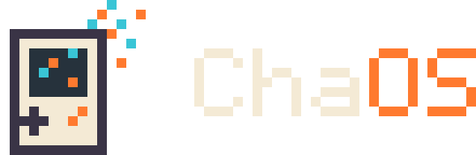
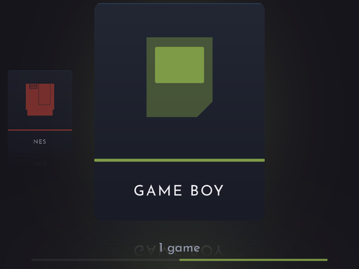
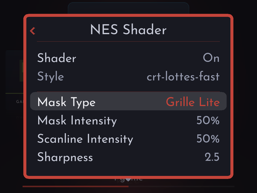
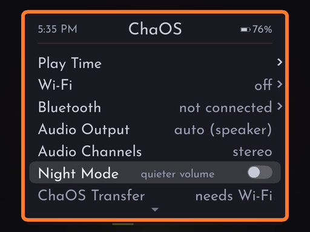
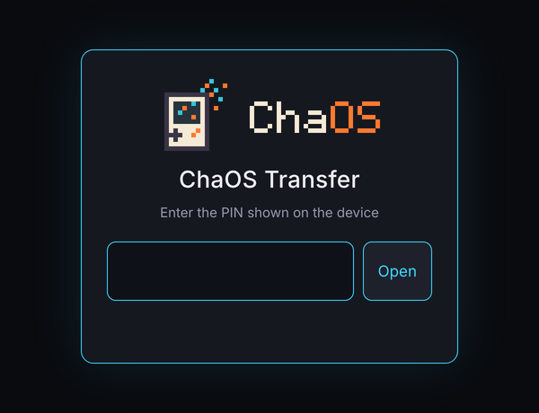

  

  <b>Custom firmware for the TrimUI Brick, with shaders made for each console built in.</b> 
  Eleven classic consoles and your music, every game at a whole-number scale, a shader and overlays for every console. 
  Built on <a href="https://github.com/ericreinsmidt/TortOS">TortOS</a> by Eric Reinsmidt.

  <a href="#install">Install</a> &nbsp;·&nbsp;
  <a href="#shaders">Shaders</a> &nbsp;·&nbsp;
  <a href="#overlays">Overlays</a> &nbsp;·&nbsp;
  <a href="#supported-systems">Systems</a> &nbsp;·&nbsp;
  <a href="#controls">Controls</a> &nbsp;·&nbsp;
  <a href="#faq">FAQ</a> &nbsp;·&nbsp;
  <a href="#credits-and-license">Credits</a>

> [!IMPORTANT]
> **ChaOS is for the TrimUI Brick (and Brick Hammer) only at this time.**
>
> **Every game is drawn at a whole-number (integer) scale only at this time.** There is no stretched or
> aspect-fit mode.

<table>
  <tr>
    <td align="center"> The shelf</td>
    <td align="center"> Each console's shader and its settings</td>
  </tr>
  <tr>
    <td align="center"> The Brick's settings in one menu, in your color</td>
    <td align="center"> ChaOS Transfer, from any browser</td>
  </tr>
</table>

## What's in it

**From ChaOS**

- **A shader for every console,** each one made for that console's screen, drawn by the Brick's CPU. PT SkyWalker541 for the Game Boys, a CRT for the TV consoles, an LCD for the other handhelds.
- **Overlays for every console,** with SkyWalker541's Brick overlays for the Game Boys included, and a folder for your own.
- **See it before you choose it:** in the in-game menu, the paused game shows each shader setting and overlay as you scroll through them.
- **Whole-number scaling** for every game, so every pixel is the same size.
- **Menu colors,** starting from ChaOS's orange.
- **ChaOS Transfer,** the boot and power-off animations, and the ChaOS look throughout.

**From TortOS**

- **Games start the moment you press A.** The emulator is already running, so nothing loads between you and the game.
- **Pick up where you left off.** Quit from the menu or press the power button: the game is saved on the way out and continues from that moment next time. Six save slots too.
- **Everything on the handheld:** Wi-Fi, box art, RetroAchievements, Bluetooth headphones and sending games over from your phone. You need a computer once, to set up the card.
- **Three ways to browse** (a row, a column or a cube) and two looks (Plain Jane or Fancy Pants).
- **Muse,** a music and audiobook player, on SELECT from anywhere.
- **Turbo buttons, fast forward, mono audio, Play Time, favorites and sorting.**
- **Your Brick stays yours.** ChaOS runs from the SD card and changes nothing on the Brick. Take the card out and it boots its own system again.

## Install

You need a TrimUI Brick or Brick Hammer, a microSD card and, just this once, a computer.

**The easy way:** [ChaOS Installer](https://github.com/SkyWalker541/ChaOS-Installer/releases/latest), for macOS, Windows and Linux. It downloads the latest ChaOS and puts it on the card, or updates a card that has ChaOS or TortOS on it already.

**By hand:**

1. Download `ChaOS-v<version>-brick.img.xz` from [Releases](https://github.com/SkyWalker541/ChaOS/releases/latest).
2. Write it to the card with a disk-image writer such as Raspberry Pi Imager or balenaEtcher. **This erases the card.**
3. Put the card in the Brick and turn it on. The first boot takes a little longer while it makes the rest of the card into space for games, music and saves.
4. Set your time zone under **MENU > Date & Time**.
5. Add games to the folders in `Roms/`: on a computer, where the card shows up as **ChaOS**, or over ChaOS Transfer.

### Updating

Put the card in the computer and choose **Update** in ChaOS Installer. Your games, music, saves and settings stay. A TortOS card becomes a ChaOS card the same way. Writing the image by hand erases the card, so use the installer to update.

### Removing

Take the card out: the Brick boots its own system again. Everything ChaOS keeps is on the card, Wi-Fi passwords and Bluetooth pairings included, so reformat it before you give it away.

## Shaders

Each console's menu (MENU on its shelf) and the in-game menu have a **Shader** row. Each console offers only the shader made for it:

| Consoles | Shader | By |
|---|---|---|
| Game Boy, Game Boy Color, Game Boy Advance | PT SkyWalker541 | SkyWalker541 |
| NES, SNES, Genesis, Master System, TurboGrafx-16 | crt-lottes-fast | Timothy Lottes, adapted by hunterk |
| Game Gear, Neo Geo Pocket, Neo Geo Pocket Color | lcd3x | Gigaherz |

- **Left and right** turn it on and off. **A** opens its settings, showing only the ones that matter for what you've chosen.
- **Reset to Recommended** puts back the shader's own settings. For PT, that's its README's settings for that console. The CRT starts flat: curvature works, but costs the CPU about twice as much.
- Settings are saved per console.

## Overlays

The **Overlay** row offers **None** or any PNG in that console's folder in `Overlays/` on the card.

- ChaOS makes a folder for every console at boot and puts in SkyWalker541's Brick overlays for the three Game Boys the first time.
- Add your own from a computer or with ChaOS Transfer, which has the same `Overlays` folder.
- Make an overlay **1024x768** with a transparent window where the game shows through. Another size is stretched to fit. The game is always drawn on top, so an overlay never covers it.

In the in-game menu, the paused game behind the menu shows the shader and overlay as you change them. **Hold Y** to hide the menu and see the whole picture (the menu says so at its foot).

## Adding games

**From a computer:** put the card in it and copy games into their console's folder in `Roms/`.

**Over Wi-Fi:**

1. Join a network under **MENU > Wi-Fi**.
2. Open **MENU > ChaOS Transfer**. It shows an address and a PIN, which is new every time.
3. Open the address in a browser on your phone or computer and type the PIN.
4. Drag games into their console's folder, albums into `Music` or books into `Audiobooks`. They're on the shelf when you leave the screen.

**Over the USB cable** (Mac, Linux or Windows 11; Windows 10 lacks the driver): plug the Brick into the computer, open **MENU > ChaOS Transfer**, then open `http://10.55.0.2` in a browser on that computer and type the PIN.

## Supported systems

| Console | Put games in | File types | Core |
|---|---|---|---|
| NES | `Roms/NES` | `.nes` `.fds` `.unf` `.unif` `.zip` | FCEUmm |
| SNES | `Roms/SNES` | `.sfc` `.smc` `.zip` | Snes9x 2010 |
| Genesis | `Roms/Genesis` | `.md` `.gen` `.bin` `.smd` `.zip` | Genesis Plus GX |
| Master System | `Roms/Master System` | `.sms` `.zip` | Genesis Plus GX |
| TurboGrafx-16 and CD | `Roms/TurboGrafx-16` | `.pce` `.sgx` `.cue` `.ccd` `.chd` `.toc` `.m3u` `.zip` | Beetle PCE Fast |
| Game Boy | `Roms/Game Boy` | `.gb` `.dmg` `.zip` | mGBA |
| Game Boy Color | `Roms/Game Boy Color` | `.gbc` `.cgb` `.zip` | mGBA |
| Game Boy Advance | `Roms/Game Boy Advance` | `.gba` `.agb` `.zip` | mGBA |
| Game Gear | `Roms/Game Gear` | `.gg` `.zip` | Genesis Plus GX |
| Neo Geo Pocket | `Roms/Neo Geo Pocket` | `.ngp` `.ngc` `.ngpc` `.npc` `.zip` | Beetle NeoPop |
| Neo Geo Pocket Color | `Roms/Neo Geo Pocket Color` | `.ngp` `.ngc` `.ngpc` `.npc` `.zip` | Beetle NeoPop |

**BIOS files** go loose in `Bios/`. Only TurboGrafx-CD games need one, `syscard3.pce`. Game Boy Advance runs without its BIOS; add `gba_bios.bin` for the original boot animation.

## Controls

| Button | What it does |
|---|---|
| **A / B** | Choose and back |
| **MENU** | Settings for whatever you're looking at. In a game: save, load, shader, overlay, quit and more |
| **SELECT** | Muse, the music and audiobook player, from anywhere |
| **MENU + R1** | Fast forward a game (2x, 3x, 4x) |
| **X / Y** | In a game, turbo A and B. On the shelf, a game's details and favorite |
| **POWER** | Save and turn off |

**In menus**

| Button | What it does |
|---|---|
| **A** | Choose, or open a row marked **›** |
| **B** | Back one screen (**‹** beside a heading means there is one to go back to). In the in-game menu, back to the game |
| **Left / Right** | Change a setting; hold to keep changing it |
| **MENU** | Close every menu at once |
| **Hold Y** | In the in-game menu: hide the menu and see the game with the shader and overlay you're on |

Every button is listed on the Brick under **MENU > Controls**, including a page for the menus, and the in-game menu reminds you that holding Y shows the game. For every menu and setting in detail, see TortOS's [guide](docs/guide.md); ChaOS follows it except where this page says otherwise.

## FAQ

<b>My games don't show up.</b>

Check the folder name against the table above, spelled exactly, and that the file type is listed for that console. A console with nothing in its folder is hidden. Games sent over ChaOS Transfer appear when you leave its screen; games copied any other way while the Brick is on appear after **Rescan Folder** in that console's menu, or after a restart.

<b>A game has no box art.</b>

**MENU > Box Art** fetches every missing cover over Wi-Fi. Sign in to a free [ScreenScraper](https://www.screenscraper.fr) account under **MENU > ScreenScraper** and it asks there first, and brings each game's year, genre and synopsis too. Otherwise it uses [libretro's thumbnail collection](https://thumbnails.libretro.com).

For a game neither has, add your own: a PNG named like the game file, in `Roms/<console>/.media/` (`Black Castle.gb` wants `Black Castle.png`, about 512 pixels on the long side). To try again for a cover you don't like, press X on the game and choose **Replace Box Art**.

<b>How do achievements work?</b>

Sign in to RetroAchievements under **MENU > Cheevos**. The first time you start a game the Brick needs Wi-Fi to download its achievements; after that it works offline, and anything you unlock offline is sent later.

<b>Can I use Bluetooth headphones?</b>

Yes. Put them in pairing mode, open **MENU > Bluetooth**, press **Y** to search and **A** to pair. They reconnect by themselves after that, and wired headphones take over whenever they're plugged in. The Brick's volume buttons reach them, and their play, pause and skip buttons control Muse.

<b>How do I add music and audiobooks?</b>

Music goes in `Music/`, a folder per artist and one per album inside it: `Music/Radiohead/The Bends/01 Planet Telex.mp3`. Each book goes in its own folder in `Audiobooks/`, as one M4B or a folder of MP3s. MP3, M4A, M4B, MP4, AAC, FLAC, Ogg, Opus and WAV all play. **MENU > Show** on Muse's shelf switches between music and books, and a book remembers where you stopped.

<b>Where are my saves?</b>

Battery saves are `.srm` files in `Saves/`, named after the game. Save states, the autosave included, are in `.userdata/shared/.tortos/`, one folder per console.

<b>Something went wrong. How do I send the logs?</b>

Open **MENU > ChaOS Transfer**, open its address in a browser, and click **Download logs** at the bottom of the first page. You get one `.tar.gz` with the last ten boots' logs and a short summary of the device, with Wi-Fi, headset and account names masked. The logs themselves are on the card in `.userdata/brick/logs/`.

## Credits and license

ChaOS is **TortOS by Eric Reinsmidt** ([TortOS](https://github.com/ericreinsmidt/TortOS), on [plastron](https://github.com/ericreinsmidt/plastron)), with ChaOS's changes by SkyWalker541. Games run in [ChaOS-diatom](https://github.com/SkyWalker541/ChaOS-diatom), a fork of Eric Reinsmidt's [diatom](https://github.com/ericreinsmidt/diatom) that adds the shaders. Who made what, and where everything came from, is in [CREDITS.md](CREDITS.md).

ChaOS is free software under the **GNU General Public License, version 3 or any later version** ([LICENSE](LICENSE)), as TortOS is: anyone may change it, share it and sell it, and whoever gets it, changed or not, gets its source and the same rights. TortOS is Copyright (c) 2026 Eric Reinsmidt; ChaOS's changes are Copyright (c) 2026 SkyWalker541.

- ChaOS-diatom is under the Mozilla Public License 2.0.
- PT SkyWalker541 is MIT; crt-lottes-fast and lcd3x are public domain.
- SkyWalker541's overlays are CC0.
- The cores keep their own licenses, two of them non-commercial.

Full notices are in [THIRD-PARTY-LICENSES.md](THIRD-PARTY-LICENSES.md) and [CREDITS.md](CREDITS.md), and every release carries the source of everything in its image.

**For developers:** ChaOS is C and SDL2. [docs/building.md](docs/building.md) is TortOS's build guide. A ChaOS release image is TortOS's release image with ChaOS's launcher, emulator, overlays, web page and boot animation swapped in, by `tools/chaos-image.sh` ([dist/README.md](dist/README.md)).
