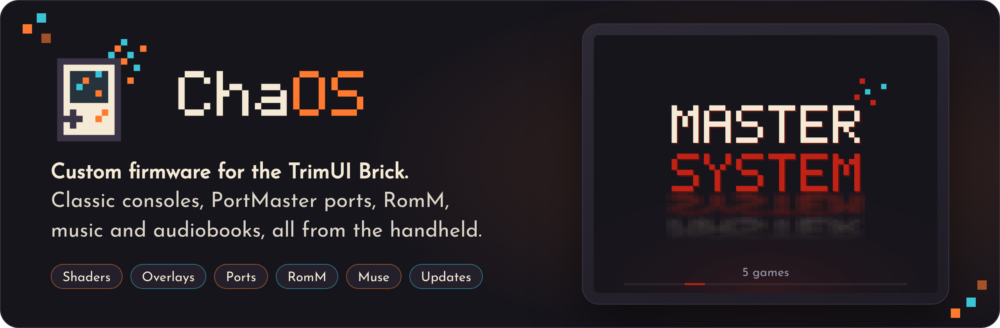

  

  
  
  

  
  &nbsp;
  

 

## Overview

ChaOS is custom firmware for the **TrimUI Brick** and **Brick Hammer**. It runs from the SD card and changes nothing on the device itself. It is built on [TortOS](https://github.com/ericreinsmidt/TortOS) by Eric Reinsmidt, and adds:

| Feature | What it does |
|---|---|
| **[Shaders and overlays](https://skywalker541.github.io/ChaOS/#shaders)** | CRT, LCD and PT SkyWalker541 looks you can tune, frames around the picture, and a [speed check](https://skywalker541.github.io/ChaOS/#speed) that says whether a game keeps full speed |
| **[Ports](https://skywalker541.github.io/ChaOS/#ports)** | PortMaster's catalog on the Brick, with runtimes and libraries fetched for you |
| **[RomM](https://skywalker541.github.io/ChaOS/#romm)** | Games, save sync and BIOS files from your own server |
| **[A look of its own](https://skywalker541.github.io/ChaOS/#shelves)** | Pixel Names and Pixel Cards themes, Game List View, letter scrubbing, menu colors |
| **[Rewind, mapping, screenshots](https://skywalker541.github.io/ChaOS/#playing)** | Alongside TortOS's instant start, resume, fast forward, turbo and RetroAchievements |
| **[Transfer and Wire](https://skywalker541.github.io/ChaOS/#transfer)** | Add games and covers from any browser, over Wi-Fi or the USB cable |
| **[Updates](https://skywalker541.github.io/ChaOS/#updates)** | Over Wi-Fi, keeping your games, saves and settings |

The **[website](https://skywalker541.github.io/ChaOS/)** has the full tour: the Brick's own screens, a setup walkthrough, every button shortcut, and an FAQ.

## Getting started

1. Download **[ChaOS Installer](https://github.com/SkyWalker541/ChaOS-Installer/releases/latest)** for macOS, Windows or Linux, and let it set up your microSD card. It also updates a card that already has ChaOS or TortOS, keeping everything on it.
2. Put the card in the Brick and turn it on.
3. Follow the **[setup guide](https://skywalker541.github.io/ChaOS/#start)**.

Prefer to do it by hand? Write `ChaOS-v<version>-brick.img.xz` from [Releases](https://github.com/SkyWalker541/ChaOS/releases/latest) to the card with a disk-image writer. That erases the card.

> [!NOTE]
> ChaOS is for the TrimUI Brick and Brick Hammer only, and is still in active development. Keep a copy of your saves, and please [report what you find](https://github.com/SkyWalker541/ChaOS/issues) with the logs from ChaOS Transfer.

## Documentation

| Where | What's there |
|---|---|
| **[Website](https://skywalker541.github.io/ChaOS/)** | Features, setup, buttons, updates and FAQ |
| **[Guide](docs/guide.md)** | Every menu row and setting, in depth |
| **[Building](docs/building.md)** | Building ChaOS from source |
| **[Release images](dist/README.md)** | How a ChaOS image is put together |
| **[Credits](CREDITS.md)** | Everyone whose work is in ChaOS, with sources and licences |

## Credits and license

ChaOS is a fork of **[TortOS](https://github.com/ericreinsmidt/TortOS) by Eric Reinsmidt**, on his [plastron](https://github.com/ericreinsmidt/plastron), with ChaOS's changes by SkyWalker541. Games run in [ChaOS-diatom](https://github.com/SkyWalker541/ChaOS-diatom), a fork of his [Diatom](https://github.com/ericreinsmidt/diatom). Ports come from [PortMaster](https://portmaster.games). Shaders, cores, overlays, art and libraries are by many others, all named in [CREDITS.md](CREDITS.md) and on the [website](https://skywalker541.github.io/ChaOS/#credits).

ChaOS is free software under the **GNU General Public License, version 3 or later** ([LICENSE](LICENSE)), as TortOS is. TortOS is Copyright (c) 2026 Eric Reinsmidt; ChaOS's changes are Copyright (c) 2026 SkyWalker541. ChaOS-diatom is under the Mozilla Public License 2.0, and everything else keeps its own licence ([THIRD-PARTY-LICENSES.md](THIRD-PARTY-LICENSES.md)). Two of the emulator cores, Snes9x 2010 and Genesis Plus GX, forbid commercial use, so ChaOS images may not be sold. Every release includes the source of everything in its image.

 

  

